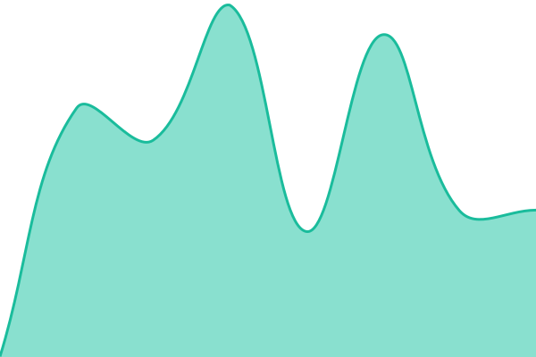
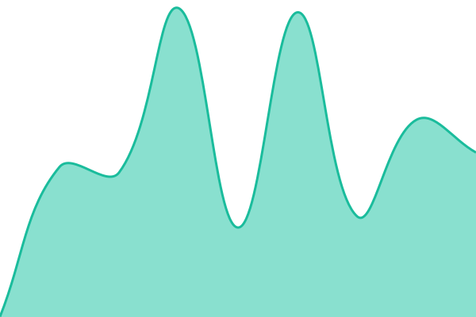
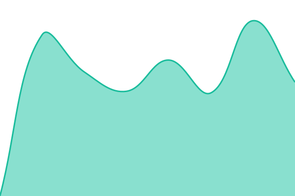
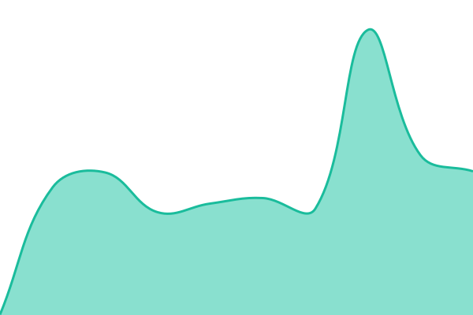
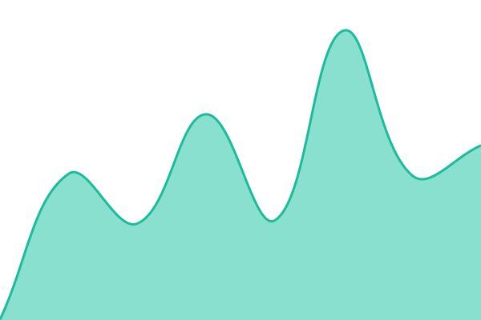
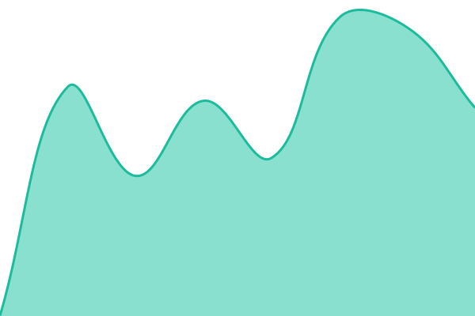

# Boarda Status

Live status: <!--live status--> **🟩 All systems operational**

<!--start: status pages-->
<!-- This summary is generated by Upptime (https://github.com/upptime/upptime) -->
<!-- Do not edit this manually, your changes will be overwritten -->
<!-- prettier-ignore -->
| URL | Status | History | Response Time | Uptime |
| --- | ------ | ------- | ------------- | ------ |
|  [Boarda Studio](https://console.boarda.io/api/health) | 🟩 Up | [studio.yml](https://github.com/boarda/boarda-status/commits/HEAD/history/studio.yml) | 

 381ms
     
 | 

<a href="https://status.boarda.io/history/studio">100.00%</a>
    

|  [Boarda Account](https://account.boarda.io/api/health) | 🟩 Up | [account.yml](https://github.com/boarda/boarda-status/commits/HEAD/history/account.yml) | 

 514ms
     
 | 

<a href="https://status.boarda.io/history/account">100.00%</a>
    

|  [Boarda Developers](https://developers.boarda.io/api/health) | 🟩 Up | [developers.yml](https://github.com/boarda/boarda-status/commits/HEAD/history/developers.yml) | 

 771ms
     
 | 

<a href="https://status.boarda.io/history/developers">100.00%</a>
    

|  [Boarda Cast](https://cast.boarda.io/api/health) | 🟩 Up | [cast.yml](https://github.com/boarda/boarda-status/commits/HEAD/history/cast.yml) | 

 366ms
     
 | 

<a href="https://status.boarda.io/history/cast">100.00%</a>
    

|  [Boarda API Gateway](https://api.boarda.io/_health) | 🟩 Up | [api-gateway.yml](https://github.com/boarda/boarda-status/commits/HEAD/history/api-gateway.yml) | 

 368ms
     
 | 

<a href="https://status.boarda.io/history/api-gateway">100.00%</a>
    

|  [Boarda Website](https://boarda.io) | 🟩 Up | [website.yml](https://github.com/boarda/boarda-status/commits/HEAD/history/website.yml) | 

 642ms
     
 | 

<a href="https://status.boarda.io/history/website">100.00%</a>
    

|  [Boarda Browser - Web](https://app.boarda.io) | 🟩 Up | [browser-web.yml](https://github.com/boarda/boarda-status/commits/HEAD/history/browser-web.yml) | 

 356ms
     
 | 

<a href="https://status.boarda.io/history/browser-web">100.00%</a>
    

|  [Boarda Space pages](https://spaces.boarda.io/api/health) | 🟩 Up | [spaces.yml](https://github.com/boarda/boarda-status/commits/HEAD/history/spaces.yml) | 

 303ms
     
 | 

<a href="https://status.boarda.io/history/spaces">100.00%</a>
    

|  [Boarda Ads](https://ads.boarda.io/api/health) | 🟩 Up | [ads.yml](https://github.com/boarda/boarda-status/commits/HEAD/history/ads.yml) | 

 307ms
     
 | 

<a href="https://status.boarda.io/history/ads">100.00%</a>
    

|  [Boarda Pages](https://pages.boarda.io/api/health) | 🟩 Up | [pages.yml](https://github.com/boarda/boarda-status/commits/HEAD/history/pages.yml) | 

 306ms
     
 | 

<a href="https://status.boarda.io/history/pages">100.00%</a>
    

|  [Boarda Community](https://community.boarda.io/api/health) | 🟩 Up | [community.yml](https://github.com/boarda/boarda-status/commits/HEAD/history/community.yml) | 

 340ms
     
 | 

<a href="https://status.boarda.io/history/community">100.00%</a>
    

|  [Boarda Support](https://support.boarda.io/api/health) | 🟩 Up | [support.yml](https://github.com/boarda/boarda-status/commits/HEAD/history/support.yml) | 

 357ms
     
 | 

<a href="https://status.boarda.io/history/support">100.00%</a>
    

|  [Boarda Help Center](https://help.boarda.io) | 🟩 Up | [help.yml](https://github.com/boarda/boarda-status/commits/HEAD/history/help.yml) | 

 235ms
     
 | 

<a href="https://status.boarda.io/history/help">100.00%</a>
    

|  [Boarda MCP](https://mcp.boarda.io/_health) | 🟩 Up | [mcp.yml](https://github.com/boarda/boarda-status/commits/HEAD/history/mcp.yml) | 

 231ms
     
 | 

<a href="https://status.boarda.io/history/mcp">100.00%</a>
    

|  [Appointments](https://appointments.apps.boarda.io/health) | 🟩 Up | [app-appointments.yml](https://github.com/boarda/boarda-status/commits/HEAD/history/app-appointments.yml) | 

 288ms
     
 | 

<a href="https://status.boarda.io/history/app-appointments">100.00%</a>
    

|  [Check-in](https://ioboardaappcheckin-production.up.railway.app/health) | 🟩 Up | [app-checkin.yml](https://github.com/boarda/boarda-status/commits/HEAD/history/app-checkin.yml) | 

 231ms
     
 | 

<a href="https://status.boarda.io/history/app-checkin">100.00%</a>
    

|  [City Pass](https://ioboardaappcitypass-production.up.railway.app/health) | 🟩 Up | [app-city-pass.yml](https://github.com/boarda/boarda-status/commits/HEAD/history/app-city-pass.yml) | 

 232ms
     
 | 

<a href="https://status.boarda.io/history/app-city-pass">100.00%</a>
    

|  [MeinTurnierplan](https://meinturnierplan.apps.boarda.io/health) | 🟩 Up | [app-meinturnierplan.yml](https://github.com/boarda/boarda-status/commits/HEAD/history/app-meinturnierplan.yml) | 

 261ms
     
 | 

<a href="https://status.boarda.io/history/app-meinturnierplan">100.00%</a>
    

|  [Order Kiosk](https://order-kiosk.apps.boarda.io/health) | 🟩 Up | [app-order-kiosk.yml](https://github.com/boarda/boarda-status/commits/HEAD/history/app-order-kiosk.yml) | 

 309ms
     
 | 

<a href="https://status.boarda.io/history/app-order-kiosk">100.00%</a>
    

|  [Queues](https://queues.apps.boarda.io/health) | 🟩 Up | [app-queues.yml](https://github.com/boarda/boarda-status/commits/HEAD/history/app-queues.yml) | 

 268ms
     
 | 

<a href="https://status.boarda.io/history/app-queues">100.00%</a>
    

|  [Stamp Passport](https://ioboardaappstamps-production.up.railway.app/health) | 🟩 Up | [app-stamps.yml](https://github.com/boarda/boarda-status/commits/HEAD/history/app-stamps.yml) | 

 236ms
     
 | 

<a href="https://status.boarda.io/history/app-stamps">100.00%</a>
    

|  [Stripe Payments](https://ioboardaappstripe-production.up.railway.app/health) | 🟩 Up | [app-stripe.yml](https://github.com/boarda/boarda-status/commits/HEAD/history/app-stripe.yml) | 

 238ms
     
 | 

<a href="https://status.boarda.io/history/app-stripe">100.00%</a>
    

|  [Tournament](https://tournament.apps.boarda.io/health) | 🟩 Up | [app-tournament.yml](https://github.com/boarda/boarda-status/commits/HEAD/history/app-tournament.yml) | 

 308ms
     
 | 

<a href="https://status.boarda.io/history/app-tournament">100.00%</a>
    

<!--end: status pages-->

Powered by [Upptime](https://github.com/upptime/upptime).
